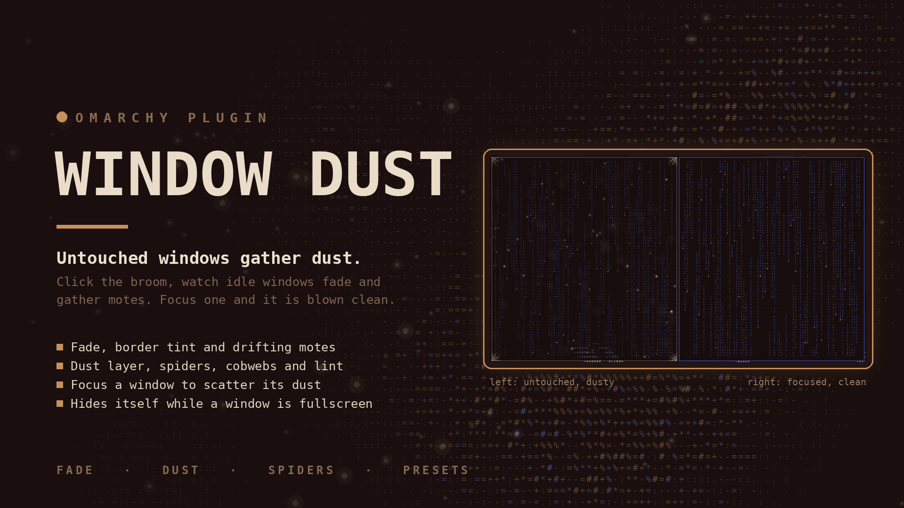

# Window Dust

An [Omarchy](https://omarchy.org) shell bar widget that lets untouched windows slowly gather dust. Focus one and it is wiped clean.

Click the broom icon in the bar to see which windows are dusty, tune how fast dust settles, and choose which effects appear: fading, tinted borders, drifting motes, static grain, grime smudges, falling streaks and corner cobwebs.



## Features

- **Fade + tint**: each untouched window's inactive opacity drops from 95% toward a floor you choose, and its inactive border is tinted a warm grey. Focus it and it snaps clean.
- **Particle overlay**: a click-through layer-shell canvas per monitor draws real dust on top of each window, clipped to the window rect so nothing bleeds onto the desktop.
- **Eight effect kinds**, each toggled independently:
  - **dust layer**: a fine powder over the whole window, with a haze that is thicker toward the bottom and piles up in the corners. It builds up with the dust level;
  - **spiders**: small spiders that crawl across a dusty window, stop, turn and carry on, and scurry away from the point you focus;
  - **fibres**: loose strands of lint that drift and turn slowly;
  - **motes** (drifting specks with a faint halo), **grain** (tiny sharp static flecks), **smudges** (large soft grime blobs), **streaks** (falling drips) and **cobwebs** (thin arcs in a window corner, only at high dust).
- **Fullscreen aware**: while a window is fullscreen, the dust on that monitor disappears completely (the overlay is hidden, so it never covers the fullscreen window) and comes back, where it was, when you leave fullscreen. Other monitors are unaffected.
- **Workspace aware**: effects only appear on the active workspace of each monitor. Switch away and they vanish; switch back and they resume exactly where they were.
- **Focus scatter**: focusing a window blows its particles outward before the window snaps clean.
- **Dust clock**: only advances while you're actually at the machine, so coming back after a night away doesn't bury everything.
- **Exempt classes**: apps like `mpv` and `spotify` never gather dust by default.
- **Presets**: Gentle, Normal, Dramatic, Demo (2 min).
- **Keyboard friendly**: everything is reachable from the panel; `Esc` closes it, and so does a click outside.
- **Themed**: Follow Omarchy (the bar's own colours with your theme's accent), Custom (starts from a warm brown) or Monochrome.

## Install

```bash
omarchy plugin add https://github.com/qempexe/omarchy-window-dust.git --enable --yes
```

Or by hand: copy this directory to `~/.config/omarchy/plugins/io.github.qempexe.window-dust/` (the folder name must match the plugin id), then:

```bash
omarchy-shell shell rescanPlugins
omarchy plugin enable io.github.qempexe.window-dust
```

Add the widget to your bar layout in `~/.config/omarchy/shell.json`, under `bar` → `layout` → the section you want (`left`, `center` or `right`):

```json
{ "id": "io.github.qempexe.window-dust" }
```

Then restart the shell:

```bash
omarchy restart shell
```

### See it work in 2 minutes

Click the broom icon, open **Settings**, pick the **Demo (2 min)** preset, then leave a window alone. After ~15 s it starts fading and gathering motes; after two minutes it is fully dusty and cobwebbed. Focus it to see it snap clean. Pick **Normal** afterwards.

## Usage

| Action | How |
| --- | --- |
| Open / close the panel | Left-click the broom icon, `Esc` or a click outside to close |
| Dust everything off (reset all windows) | Right-click the icon, or use "Dust everything off" in the panel |
| Pause / resume | Middle-click the icon, or use "Pause"/"Resume" in the panel |
| Focus a dusty window | Click its row in the Windows tab (particles scatter first) |
| Never dust that app | Right-click its row in the Windows tab |
| Back / close | `Esc` |

The number next to the icon is how many windows are noticeably dusty.

## Settings

Open **Settings** in the panel. Everything applies instantly and is saved to `~/.config/omarchy/window-dust.json`. You can also edit that file by hand: it is watched, so changes apply live, and typos are ignored. Only the settings you changed are written; the rest use their defaults.

### Theme and bar

| Setting | File key | Default | Meaning |
| --- | --- | --- | --- |
| Colours | `theme` | follow | `follow`, `custom`, `mono` (an old `brown` is read as `custom`) |
| Custom colours | `customBackground`, `customText`, `customAccent` | brown palette | `#rrggbb`, used when Colours is Custom |
| Bar icon | `barIcon` | broom glyph | Text or glyph shown in the bar (up to 8 characters) |
| Show dusty count | `barShowCount` | true | The number of dusty windows next to the icon |

### Timing

| Setting | File key | Default | Meaning |
| --- | --- | --- | --- |
| Preset | n/a | Normal | Gentle, Normal, Dramatic, Demo (2 min) |
| Dust starts after | `dustAfterMinutes` | 20 | How long a window stays untouched before the first speck |
| Settles fully over | `settleMinutes` | 180 | How long dust then takes to reach its maximum (**this is the speed**) |
| Stages | `stages` | 8 | Visible steps from clean to fully dusty; more = smoother |
| How dust settles | `curve` | smooth | `smooth`, `linear`, `early`, `late` |

### Look

| Setting | File key | Default | Meaning |
| --- | --- | --- | --- |
| Fades down to | `minOpacity` | 0.55 | Inactive opacity when fully dusty |
| Dust colour | `dustColor` | 8b8378 | Colour for particles and border tint, any `RRGGBB` hex |
| Border tint | `tintBorder` | true | Tint the border as well as fading |
| Effect types | `effectPowder`, `effectSpiders`, `effectFibers`, `effectMotes`, `effectGrain`, `effectSmudges`, `effectStreaks`, `effectCobwebs` | all true | Toggle each effect independently |

If every effect type is off, nothing is drawn: only the fade and border tint remain.

### Particles

| Setting | File key | Default | Meaning |
| --- | --- | --- | --- |
| Particles | `particles` | true | Master switch for the overlay layer |
| Density | `particleDensity` | 0.22 | Particles per 1000 px² of window area |
| Max per window | `particleMax` | 240 | Hard cap, so a fullscreen 4K window doesn't melt your GPU |
| Speck size (max) | `particleSizeMax` | 2.6 | Largest mote radius in px |
| Drift speed | `particleDrift` | 4 | Base random-walk speed in px/s |
| Brightness | `particleOpacity` | 0.75 | Multiplier on top of the dust level |
| Twinkle | `particleTwinkle` | true | Subtle brightness pulse per particle |
| Scatter on focus | `scatterOnFocus` | true | Blow particles outward (and send spiders running) when a window is focused |
| Dust layer amount | `powderDensity` | 8 | Fine specks per 1000 px² at full dust (capped at 7000 per window) |
| Spiders per window | `spiderMax` | 2 | The most spiders a large window can have; small windows get fewer, tiny ones none |
| Hide in fullscreen | `hideOnFullscreen` | true | No dust on a monitor while one of its windows is fullscreen |

### Away and exempt

| Setting | File key | Default | Meaning |
| --- | --- | --- | --- |
| Pause dust while away | `pauseWhenAway` | true | The dust clock stops while you're idle or locked |
| Away after | `awayMinutes` | 5 | Idle time before you count as away |
| Never dusted | `exempt` | mpv, vlc, spotify | Window classes that never gather dust |

### File-only

| File key | Default | Meaning |
| --- | --- | --- |
| `enabled` | true | Master switch (same as Pause) |
| `startOpacity` | 0.95 | Opacity at the first speck |
| `particleSizeMin` | 0.8 | Smallest mote radius |

Values are clamped to sensible ranges, so a bad edit can't break anything.

## How it works

- A per-window "last touched" time is tracked from Hyprland focus events. Only focus counts, so merely looking at a window doesn't clean it.
- The **dust clock** only advances while you're at the machine, so coming back after a night away doesn't bury everything (turn this off if you prefer wall-clock time).
- Opacity and border colour are applied with Hyprland's Lua `set_prop` dispatcher (`opacity_inactive`, `inactive_border_color`), and only when a window moves to a new stage, so it makes very few IPC calls.
- Hyprland drops `set_prop` overrides on a config reload (for example a theme change). The plugin listens for `configreloaded` and re-applies the dust.
- One click-through layer-shell overlay (`WlrLayer.Overlay`, namespace `window-dust-overlay`) is created per monitor. A ~30 Hz timer advances every particle, clipping each window's set to that window's rect at paint time.
- Which windows are drawn is decided by comparing each window's workspace id (from `hyprctl -j clients`) against each monitor's active workspace id (from `hyprctl -j monitors`). Hyprland fires `workspacev2`, `focusedmon`, and `moveworkspacev2` when the active workspace changes, so effects vanish within a frame of switching.
- Particle state survives workspace switches — switch away and back, and the dust resumes exactly where it was, rather than re-spawning.
- Settings live in `SettingsStore.qml`: a copy in memory (instant) saved to `window-dust.json`, with the file watched for hand edits. Nothing is sent to `omarchy bar set`, which would reload the whole shell.
- The panel is its own popup window (`Panel.qml`). `Foreground.qml` is a hidden probe that hands the bar's own foreground and background colours to it, so Follow Omarchy matches a light or dark bar exactly.
- Changes that only affect looks (theme, bar icon) never restart the dust engine; changes to anything else respawn the particles and re-apply the window fades once.
- Disabling or removing the plugin restores every window it touched.

## Data and privacy

- Your settings live in `~/.config/omarchy/window-dust.json` and the dust clock + per-window last-touched timestamps live in `~/.local/state/omarchy-window-dust/state.json`. Nothing else is stored.
- The only external process it runs is `hyprctl` (to read `clients` and `monitors`), plus a shell `cat` for the dust state. It also reads, never writes, `~/.config/omarchy/current/theme/colors.toml` for the theme accent. No network access.
- Plugins run unsandboxed in the shell process. This one writes only its own two files.

## Limitations

- Effects are clipped to each window rect. There's no dust on the desktop wallpaper or in gaps between windows.
- The particle overlay is drawn per monitor; if the overlay fails to spawn on your Quickshell build, the fade and border tint still work. Check `qs log -p "$OMARCHY_PATH/shell" --tail 100` for `window-dust-overlay` warnings.
- Cobwebs only appear above ~50% dust, and spiders above ~25%; below that only the other effects are drawn.
- Only true fullscreen hides the dust. A maximised window (which keeps the bar and gaps) still shows it.
- The dust clock is not wall-clock by default, so a window left for 48 h while you're away for most of it won't be as dusty as the raw time suggests. Turn **Pause dust while away** off if you want wall-clock semantics.

## Files

| File | Purpose |
| --- | --- |
| `manifest.json` | Omarchy plugin manifest |
| `BarWidget.qml` | Bar icon, dust engine, overlay spawning, settings and theme |
| `Overlay.qml` | Full-screen click-through particle canvas (one per monitor) |
| `Panel.qml` | The popup panel: Windows tab and Settings tab |
| `Foreground.qml` | Hidden probe that exposes the bar's colours to the panel |
| `SettingsStore.qml` | Settings kept in memory and saved to `window-dust.json` |
| `Settings.js` | The list of settings the Settings tab is built from |
| `Model.js` | Pure logic: settings, dust maths, particles, theme colours, Lua dispatchers |
| `FieldBox.qml`, `FlatButton.qml`, `SectionLabel.qml` | Small UI pieces |
| `tests/` | Unit tests for `Model.js` and `Settings.js` (`node tests/schema.test.js`) |

## Development

Plugin files under `~/.config/omarchy/plugins/` are watched, but changes to the overlay spawning only show up reliably after:

```bash
omarchy restart shell
```

To check the manifest:

```bash
omarchy plugin validate .
```

To lint the QML:

```bash
qmllint -I "$OMARCHY_PATH/shell" BarWidget.qml Overlay.qml Panel.qml Foreground.qml SettingsStore.qml FieldBox.qml FlatButton.qml SectionLabel.qml
```

## Updating

```bash
omarchy plugin update io.github.qempexe.window-dust
omarchy restart shell
```
The first command pulls the latest version. The second is required because the shell doesn't reliably reload changed QML on its own - without it, you'll still be running the old code.


## Uninstall

```bash
omarchy plugin remove io.github.qempexe.window-dust
```

If this does not edit `shell.json`: remove the `{ "id": "io.github.qempexe.window-dust" }` entry from your bar layout by hand. Then restart the shell:

```bash
omarchy restart shell
```

To also delete your saved settings and dust state:

```bash
rm ~/.config/omarchy/window-dust.json
rm -rf ~/.local/state/omarchy-window-dust
```

Both are optional. Leave them if you might reinstall and want your settings back.

## License

[MIT](LICENSE)
