<p align="center">
  <picture>
    <source media="(prefers-color-scheme: light)" srcset="assets/logo-dark.png">
    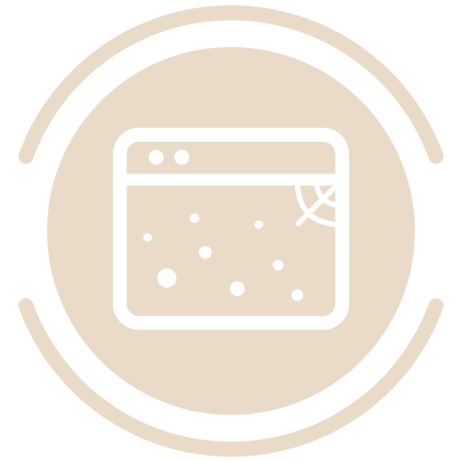
  </picture>
</p>

<h1 align="center">Window Dust</h1>

<p align="center">Windows you leave alone on your <a href="https://omarchy.org">Omarchy</a> desktop slowly fade and gather dust. Focus one and the dust flies off.</p>

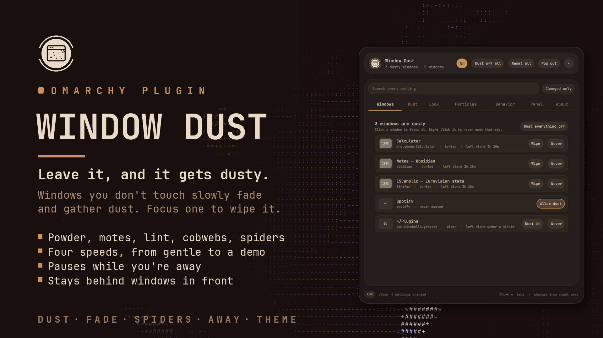

A window you haven't touched for a while starts to fade, its border takes on a dusty
tint, and dust settles on it: a fine powder that piles up toward the bottom and in the
corners, drifting motes, grime, loose strands of lint, cobwebs in the corners, and in
the end a few small spiders walking about. Focusing the window blows it all away.

The clock only runs while you're at the machine, so coming back after a night away
doesn't bury everything. The button on the bar shows how many windows are dusty.

## Features

- **Eight kinds of dust**, each on its own switch: a dust layer, motes, grain, smudges,
  streaks, fibres, cobwebs and spiders.
- **A fade and a dusty border**, set through Hyprland, only when a window gets dustier.
- **Four speeds to start from**: Gentle, Normal, Dramatic, and a Demo that is fully
  dusty in two minutes. Timing, curve and stages can all be set apart.
- **A Windows tab** with every window, how long it has been left alone and how dusty it
  is: focus it, wipe it, dust it at once, or never dust it again.
- **Stays where it belongs**: drawn only on the workspace you're looking at, hidden while
  a window is fullscreen, and kept off any window in front of a dusty one.
- **Pauses while you're away**, and keeps the dust across restarts.
- **Fast**: one engine for all your bars and screens, small canvases for each dusty
  window, and nothing drawn at all while no window is dusty.
- **Settings in the house style**: a bar panel or its own window, a search over every
  tab, colors that follow your theme or its window border, and an About tab.

### The dust

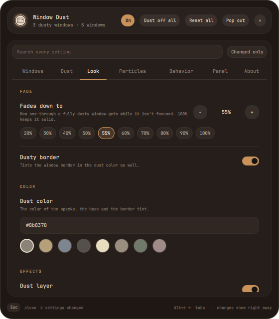

The **dust layer** is the base: a powder over the whole window, thicker toward the
bottom and in the corners. Every speck comes from the window's own address, so the
same window always gets the same powder, and it scales when the window is resized.

The moving dust comes on top: **motes** drift with a faint halo, **grain** is tiny
and sharp, **smudges** are large soft blobs, **streaks** run down, **fibres** turn
slowly, **cobwebs** appear in the corners once a window is half dusty, and
**spiders** walk across it, stop, turn, and run when you focus it.

The dust color is one setting for the specks, the haze and the border tint, with a
few colors to start from: dust, sand, ash, soot, mote and more.

<br clear="right">

### Speeds

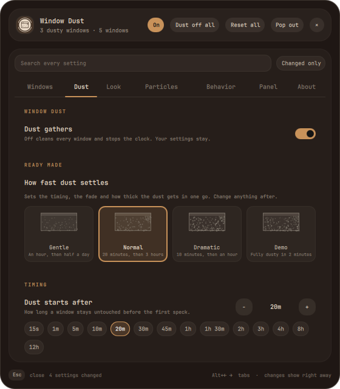

**Dust starts after** is how long a window is left alone before the first speck, and
**Settles fully over** how long it then takes to get as dusty as it gets. **How dust
settles** picks the shape of that build-up, and **Stages** how many steps it takes.

The four ready made speeds set these together with the fade and how thick the dust
gets. Anything can be changed after.

<br clear="right">

### The windows

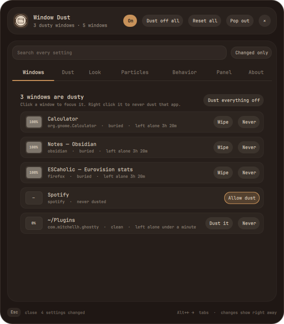

The Windows tab lists every window, the dustiest first, with a little meter. Click a
window to focus it. **Wipe** cleans it without focusing it, **Dust it** makes it fully
dusty at once (handy to see your settings), and **Never** puts its app on the
never-dusted list. A right click on a window does that too.

Apps on the never-dusted list (mpv, vlc and spotify to start with) stay clean, and so
can every floating window.

<br clear="right">

## Installation

```bash
omarchy plugin add https://github.com/qempexe/omarchy-window-dust.git --enable --yes
omarchy restart shell
```

Window Dust runs while its button is part of the bar layout. Place it with the bar
settings, or write `{ "id": "io.github.qempexe.window-dust" }` into `bar` → `layout`
in `~/.config/omarchy/shell.json`.

To see it work at once: open the panel, pick **Demo** on the Dust tab, and leave a
window alone. After a few seconds it starts to fade and gather dust; after two minutes
it is fully dusty and cobwebbed. Focus it to see the dust fly off, then pick **Normal**.

## Usage

### Clicking the button

| Mouse | Result |
| --- | --- |
| Left | the panel |
| Right | dust everything off, pause, or nothing |
| Middle | pause, dust everything off, or nothing |

Right and middle click are set under **Panel** › **Button**. The number next to the
icon is how many windows are noticeably dusty.

### From a terminal

```bash
omarchy-shell io.github.qempexe.window-dust windows        # open the Windows tab (again to close)
omarchy-shell io.github.qempexe.window-dust settings       # open the settings
omarchy-shell io.github.qempexe.window-dust clean          # dust everything off
omarchy-shell io.github.qempexe.window-dust pause          # stop the dust (also: resume, toggle)
omarchy-shell io.github.qempexe.window-dust preset demo    # gentle, normal, dramatic or demo
omarchy-shell io.github.qempexe.window-dust status         # every window and its dust, as json
```

## Configuration

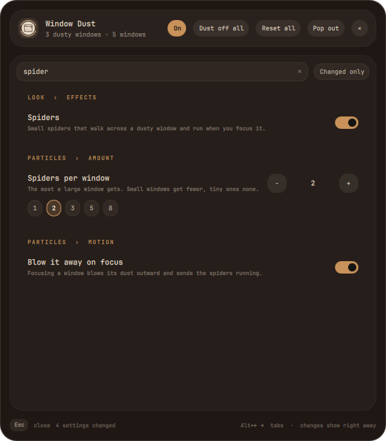

Every change shows at once and is saved to `~/.config/omarchy/window-dust.json`. The
file is watched, so a hand edit applies live too, and odd values fall back to their
defaults. **Alt+←** and **Alt+→** step through the seven tabs, the search box looks
through all of them, and **Changed only** shows what differs from the defaults.

- **Windows**: every window and its dust.
- **Dust**: on or off, the ready made speeds, and the timing.
- **Look**: the fade, the dusty border, the dust color, and every kind of dust.
- **Particles**: how much dust, how big, how fast, how bright, frames per second, and
  whether it stays behind windows in front.
- **Behavior**: pausing while you're away, hiding in fullscreen, floating windows, and
  the never-dusted list.
- **Panel**: colors (Follow theme, Window borders, Custom, Monochrome), the button and
  its clicks, and the panel's size, spacing, roundness, outline, text size and opacity.
- **About**: the version, and more plugins.

<br clear="right">

<table>
<tr>
<td></td>
<td></td>
<td></td>
<td>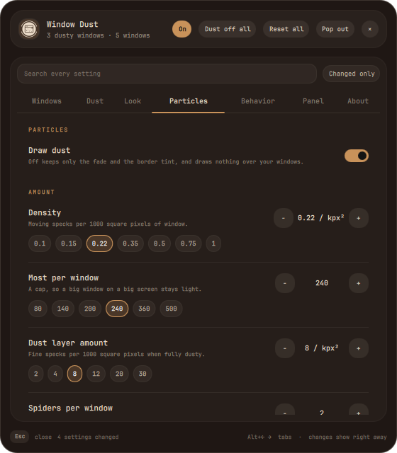</td>
</tr>
<tr>
<td>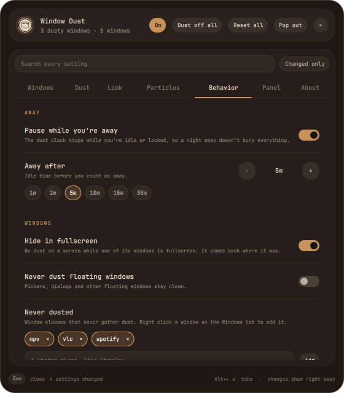</td>
<td>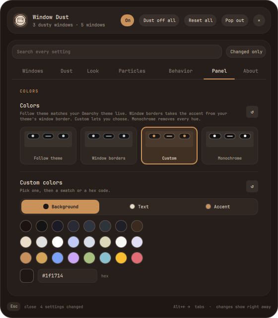</td>
<td>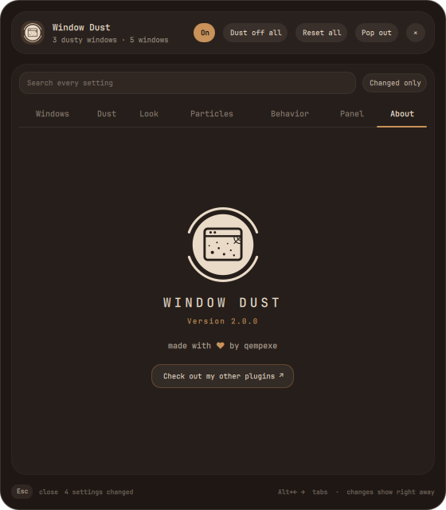</td>
<td>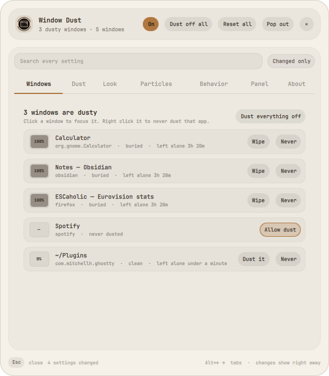</td>
</tr>
</table>

## Troubleshooting

- **How it works.** Focus is the only thing that cleans a window: Window Dust listens to
  Hyprland's focus events and keeps the time each window was last focused, on a clock
  that stops while you're away. The fade and the border tint are Hyprland's
  `opacity_inactive` and `inactive_border_color`, set with its `set_prop` dispatcher and
  only when a window moves to another stage. The dust is drawn on one click-through
  layer per screen (namespace `window-dust-overlay`).
- **Omarchy 4.5.** The panel opens off the bar there too, where the bar window spans the
  whole screen.
- **A theme switch** or any Hyprland config reload drops the fade and the tint; Window
  Dust gives them again right after.
- **No dust shows.** Check that **Draw dust** is on (Particles) and that at least one kind
  of dust is on (Look). With all of them off, only the fade and the tint remain.
- **Maximised windows** keep their dust; only real fullscreen hides it.
- **Overlapping windows.** Dust stays off floating windows in front of a dusty one. Two
  tiled windows never overlap, so this only matters for floating ones.
- Window Dust runs `hyprctl -j clients` and `hyprctl -j monitors` to see the windows, and
  nothing else. It makes no network requests, and only writes its settings and
  `~/.local/state/omarchy-window-dust/state.json`. Removing it restores every window.

## Contributing

Bug reports and ideas are welcome as [issues](https://github.com/qempexe/omarchy-window-dust/issues). [CONTRIBUTING.md](CONTRIBUTING.md) describes how the code fits together and how to test it. Everyone taking part is expected to follow the [code of conduct](CODE_OF_CONDUCT.md). What changed in each version is in the [changelog](CHANGELOG.md).

### Source layout

```
qml/
├── Service.qml          the settings, the dust clock, what Hyprland is told, the
│                        particles, the overlays and the ipc
├── BarWidget.qml        the bar button
├── overlay/Overlay.qml  the click-through layer on each screen, and the drawing
├── core/                SettingsStore (window-dust.json), UiState (colors, sizes)
├── panel/               Panel, PopoutWindow, PanelView, SettingsView, SettingRow,
│                        WindowsPage, PresetGrid, TileArt, AboutPage
├── controls/            Btn, Chip, Sw, Txt, TextBox
└── js/                  Schema.js (every setting), Model.js (the dust and the
                         particles), Theme.js, Util.js
assets/                  the logo, light and dark
tests/test_model.js      node tests/test_model.js
```

### Upgrading and uninstalling

```bash
omarchy plugin update io.github.qempexe.window-dust
omarchy restart shell
```

Settings from 1.x carry over as they are. To remove it, along with its settings and
the saved dust:

```bash
omarchy plugin remove io.github.qempexe.window-dust
omarchy restart shell
rm ~/.config/omarchy/window-dust.json
rm -rf ~/.local/state/omarchy-window-dust
```

## License and credits

[MIT](LICENSE).

- Thanks to the **Omarchy** project for the shell and the bar, to **Hyprland**, and to **Quickshell** and **Qt** for the toolkit.
- Thanks to everyone who tests it and reports issues.

Window Dust is an independent community plugin. It is not affiliated with or endorsed by Omarchy.
